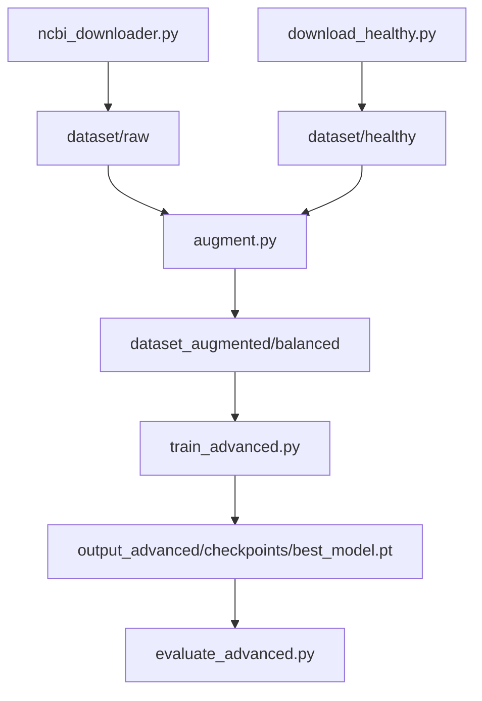

# Rebuild avian influenza data-to-test flow

## What exists today (and why it feels broken)

The repo is **not missing a model** — it already has a hybrid PyTorch engine (`GenomicClassificationEngine` in [Genomic_Framework/engine.py](Genomic_Framework/engine.py): DNABERT-2-inspired + HyenaDNA-inspired + mutation tensor + MLP). What is missing is a **single connected flow from public data → clean labels → train → test**.

Current intended (but disconnected) path:



**Breaks found in code and audits:**

- **No datasets on disk** in this workspace. `dataset/` and `dataset_augmented/` are gitignored; Glob found 0 FASTA files. Training will fail immediately (`FileNotFoundError` in [Genomic_Framework/pipeline/preprocessor.py](Genomic_Framework/pipeline/preprocessor.py)).
- **Downloader is scientifically unsafe.** [ncbi_downloader.py](ncbi_downloader.py) searches `"{subtype}"[All Fields]`, caps at **1000 records/subtype**, and does not require Influenza A TaxID 11320 or host Aves. That is why audits found snail contigs, bacteria, rodent mRNA, and vaccine constructs in `dataset/raw/`.
- **Labels are wrong.** `SUBTYPE_TO_CLASS` in [preprocessor.py](Genomic_Framework/pipeline/preprocessor.py) and [data_augmentation_pipeline.py](data_augmentation_pipeline.py) maps folder names to 4 classes and puts **poultry genomes** in Class 0. Audits: 94.8% of “Benign” was duck mRNA; H7N2 labeled “likely benign” but often HPAI cleavage; train/test **accession leakage 88.6%**. The 98% README number is not a valid test.
- **Docs oversell completeness.** [DATA_SOURCE_REGISTER.md](DATA_SOURCE_REGISTER.md) mentions ENA, DDBJ, BV-BRC, and `scripts/ingest_gisaid.py`. **None of those ingest scripts exist.** Only NCBI Entrez + poultry genome download exist.
- **Two parallel stacks:** production (`Genomic_Framework/`, `train_advanced.py`) vs toy demo (`demo/`, ~tiny conv model). Tests use dummy tensors, not real FASTA.
- **Architecture mismatch with biology:** model `seq_len=128` tokens while HA segments are ~1,700 bp; tokenizer truncates after 128 k-mers ([preprocessor.py](Genomic_Framework/pipeline/preprocessor.py) `tokenise_sequence`). Host genomes must **not** enter the viral classifier.

Influenza A is RNA; public “DNA sequences” here means **nucleotide FASTA** (cDNA/gene/segment records). We will collect those, not eukaryotic bird genomes, for training.

---

## Target taxonomy (detailed, not 4 subtypes)

A single 4-way softmax cannot represent “all avian influenza types.” We will replace it with **multi-task heads on the same backbone** (this is the new classing you asked for):

| Head | What it predicts | Why |
|---|---|---|
| **Subtype** | Dynamic `HxNy` list from metadata (H5N1, H7N9, H9N2, … including extra subtypes NCBI/ENA actually return) | Fine-grained virus type |
| **Pathotype** | `LPAI` / `HPAI` / held-out `INDETERMINATE` | WOAH rule: HA polybasic cleavage (H5/H7) or isolate-linked evidence — **not** subtype name |
| **Segment** | PB2, PB1, PA, HA, NP, NA, M, NS | Stops mixing HA cleavage biology with PB2/NS fragments |
| **Host ecology** (optional metadata flag, not sequences) | wild-bird / poultry / unknown | From isolate host field only |

Records without TaxID 11320, without a parseable subtype/segment, or without cleavage/isolate evidence for pathotype are **quarantined**, not guessed.

Classifier output in [Genomic_Framework/models/classifier.py](Genomic_Framework/models/classifier.py) and `NUM_CLASSES` in engine/config will change from `Linear(..., 4)` to **three heads**. Tests that `assert SUBTYPE_TO_CLASS["H5N1"] == 3` in [tests/test_training_modules.py](tests/test_training_modules.py) will be rewritten.

---

## Canonical on-disk format (all sources → one type)

Every free source is converted to the same pair of artifacts:

1. **FASTA:** `dataset/canonical/fasta/{accession}.fasta` — one isolate-segment per record, IUPAC ACGTN, uppercase.
2. **Manifest CSV:** `dataset/canonical/manifest.csv` with: `record_id`, `insdc_accession`, `source` (ncbi/ena/bvbrc), `organism_taxid`, `subtype`, `segment`, `host`, `country`, `collection_date`, `seq_len`, `sha256`, `pathotype`, `label_confidence`, `split`.

Layout after ingest:

```text
dataset/
  raw_sources/     # untouched NCBI/ENA dumps
  canonical/       # unified FASTA + manifest
  excluded/        # contaminants, patents, host DNA, duplicates
  splits/          # train/val/test accession lists (no leakage)
dataset_augmented/ # optional, ONLY after split
```

Poultry genomes from [download_healthy.py](download_healthy.py) stay in `dataset/host_references/` for optional mutation alignment **only**. They are never class 0.

---

## End-to-end pipeline we will implement


One orchestrator, e.g. `python run_pipeline.py --stage all`, wrapping the stages below so you do not have to remember 8 scripts.

### Stage 1 — Collect all free public sequence sets

Implement real ingest (replace the All-Fields Entrez search). **Free/open only** (GISAID is not freely redistributable; skip unless you later drop an authorized export in a staging folder).

- **NCBI Virus / Datasets API** (primary): taxon 11320, host Aves, all segments, paginate (no 1000 cap).
- **ENA Portal API**: `tax_tree(11320)` + avian host; map to same accessions.
- **BV-BRC influenza tables**: curated subtype, segment, cleavage metadata used as **label evidence**, sequences only if accession is public INSDC.
- DDBJ is INSDC-mirrored; **dedupe by accession + SHA-256**, do not triple-count.

Tighten [ncbi_downloader.py](ncbi_downloader.py) query to something like:

`txid11320[Organism:exp] AND aves[Host] AND (H5N1 OR H7N9 OR ...) AND 2010:2026[PDAT]`

plus length filters (influenza segments ~800–2400 bp, drop multi-Mb scaffolds).

Config for email / `NCBI_API_KEY` and a bulk staging path (project `dataset/` or `D:\genomic_framework_downloads` if F: is tight) in YAML, not hardcoded.

### Stage 2 — QC, contamination filter, labels

Reuse [scripts/audit_raw_viral.py](scripts/audit_raw_viral.py) / [scripts/audit_ha_cleavage.py](scripts/audit_ha_cleavage.py) ideas, but as a required gate:

- Keep Influenza A only; drop eukaryote/bacteria/patent/synthetic.
- Translate HA (segment 4); polybasic motif → HPAI, monobasic → LPAI.
- Non-HA segments inherit pathotype **only** when they share isolate/strain with a labeled HA.
- Write `DATASET_MANIFEST.csv` + exclusion report.

### Stage 3 — Leakage-free split, then optional augment

- Split by **isolate/accession**, not by FASTA file. Target ~70/15/15 **stratified on subtype × pathotype**.
- Augment **train only** ([augment.py](augment.py) / [Genomic_Framework/pipeline/augmentor.py](Genomic_Framework/pipeline/augmentor.py)). Disable or strictly limit host-genome mixing and reverse-complement leakage into val/test.
- Unify the two augment entry points (`augment.py` vs `data_augmentation_pipeline.py`) so training reads only `dataset/splits/` + train-only aug.

### Stage 4 — Fix the model enough to train for real

Keep the hybrid engine; change what it predicts and how long sequences it sees:

- Increase `seq_len` in [configs/train_config.yaml](configs/train_config.yaml) (e.g. 512 or 1024) so HA/NA are not chopped to 128 tokens; pad/truncate consistently.
- Replace 4-class head with multi-task heads + losses (subtype CE + pathotype CE + segment CE). Indeterminate pathotype excluded from pathotype loss.
- Stop requiring `dataset/healthy` in `GenomicDatasetBuilder`.
- Checkpoints: `output_advanced/checkpoints/best_model.pt` selected on **val pathotype F1 + subtype macro-F1** (not leaked test accuracy).

Smoke-test still: `python Genomic_Framework/engine.py` (synthetic forward pass).

### Stage 5 — Train to best weights, then test

Order after data is ready:

1. `python -m unittest discover -s tests -p "*.py"` (updated tests: ingest QC, label rules, split leakage = 0, multi-task forward).
2. `python train_advanced.py --config configs/train_config.yaml` → best checkpoint.
3. `python evaluate_advanced.py --checkpoint ... --dataset-root dataset/canonical` on **held-out accessions only**.
4. Publish metrics JSON under `output_advanced/metrics/` (accuracy, macro-F1 per head, MCC, confusion by subtype and pathotype). Treat old 98% / 86% figures as **invalid**.

Demo/website stay later: they currently show static JSON, not live weights. Out of scope until a real checkpoint exists, unless you want the Streamlit demo pointed at the new heads.

---

## What we will not do in this first build

- Do not retrain on the old `dataset_augmented/balanced` 4-class files if they reappear on disk — they leak and mislabel.
- Do not scrape GISAID.
- Do not treat poultry reference genomes as “benign virus.”
- Do not chase paper/website polish until eval metrics come from the new split.

---

## Success criteria

- One command (or a short documented sequence) downloads, unifies, labels, trains, and evaluates.
- Manifest covers NCBI + ENA (+ BV-BRC metadata) with zero INSDC duplicates in training.
- Zero shared accessions across train/val/test.
- Best weights written; test report generated for all three heads.
- Unit tests pass without dummy-only coverage of the data path.
